 

 

 

---

## Sobre mim

- Estudante de **Ciência da Computação** (2º período) no **Centro Universitário Uniesp** — **João Pessoa, PB**
- Experiência prática em **desenvolvimento full-stack**, construindo produtos web do front-end ao banco de dados
- Uso **Claude** e **Claude Code** no dia a dia para acelerar entregas e iterar rápido
- Interesses: **IA aplicada**, **construção e orquestração de agentes em produção**, **machine learning** e **cultura de startups**
- Em busca de **estágio em TI** ou vaga como **desenvolvedor**

---

## Experiência

### Desenvolvedor Full-stack — No Foco `06/2026 – 07/2026`
Desenvolvi funcionalidades centrais da plataforma de gestão de estudos da No Foco, que conecta alunos e assessores e conta com **mais de 40 alunos pagantes**: planejamento e ajuste de cronogramas em tempo real; sistema de metas; streak diária; ranking de questões e análise de desempenho com gráficos.

`React` `TypeScript` `Supabase` `PostgreSQL` `Docker`

---

## Stack & Ferramentas

---

## Projetos em Destaque

### [Passo Firme](https://github.com/ailtonmcneto/Passo-Firme) `08/2026 – atualmente`
Plataforma web que gera **cronogramas de estudo personalizados** de forma automática, por meio de um algoritmo que distribui as matérias de acordo com o nível de dificuldade de cada uma e o tempo disponível do aluno. *(em desenvolvimento)*

`HTML` `CSS` `JavaScript` `Java` `PostgreSQL`

### [Primeiros Cliques](https://github.com/ailtonmcneto/Primeiros-Cliques) `04/2026 – 06/2026`
Plataforma de **alfabetização digital** voltada principalmente ao público mais velho, com ensino guiado por imagens práticas e conteúdo organizado em 6 módulos: Primeiros Passos, Comunicação, Finanças, Segurança Digital, Serviços Públicos e Mercado de Trabalho.

`HTML` `CSS` `Flexbox` `Design Responsivo`

---

## GitHub Stats

 

---

## Contribuições

<picture>
  <source media="(prefers-color-scheme: dark)" srcset="https://raw.githubusercontent.com/ailtonmcneto/ailtonmcneto/output/github-contribution-grid-snake-dark.svg"/>
  <source media="(prefers-color-scheme: light)" srcset="https://raw.githubusercontent.com/ailtonmcneto/ailtonmcneto/output/github-contribution-grid-snake.svg"/>
  
</picture>

---

## Contato

